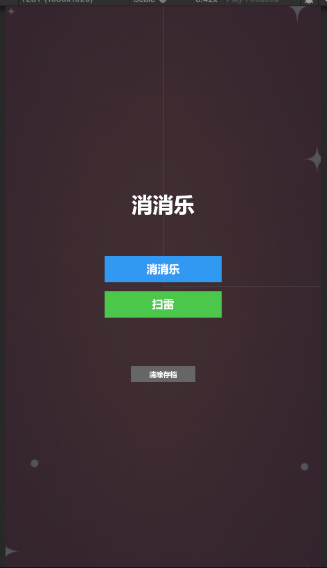
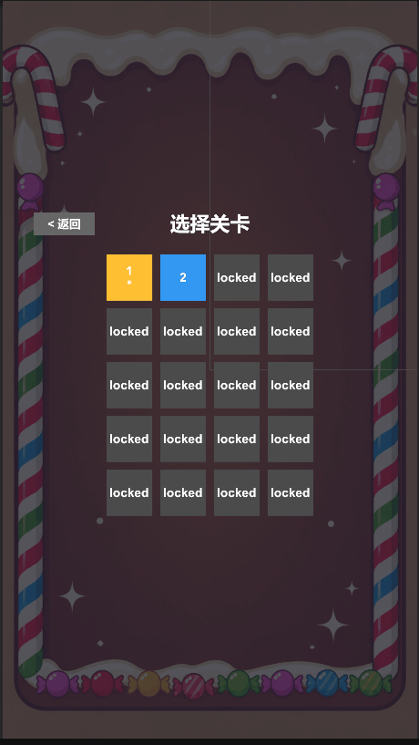
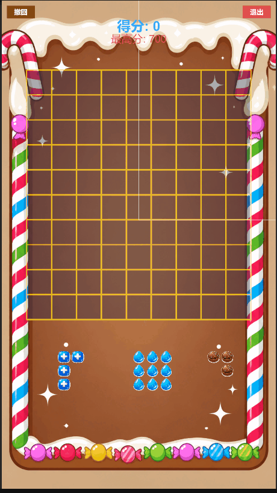
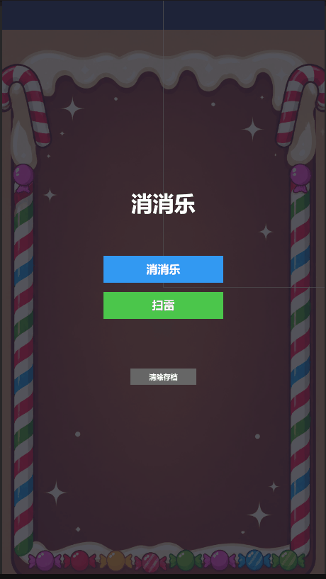

# EliminateBlocks · 多模式休闲游戏合集


基于 Unity + C# 开发的移动端休闲游戏合集，包含三种玩法：

| 模式 | 玩法 | 规模 |
| --- | --- | --- |
| 三消闯关 | 交换相邻方块，三连及以上消除，带特殊消除和连锁 | 20 关，进度持久化 |
| 方块拼图 | 1010! 玩法，把方块拖进棋盘，填满整行 / 整列即消除 | 9×10 棋盘，31 种形状 |
| 扫雷 | 经典扫雷，短按翻开、长按插旗 | 3 档难度 |

已打包 Android 并在真机上运行。

## 效果展示

| 主菜单 | 三消 | 方块拼图 | 扫雷 |
| --- | --- | --- | --- |
|  |  |  |  |


## 环境

- Unity 2022.3.62f2c1（2022.3 LTS 系列的其它版本应也能打开）
- C# / UGUI
- 目标平台：Android（已验证）；iOS 需要 Mac + Xcode，未打包

## 运行方式

1. 克隆仓库后，用 Unity Hub 的「添加 → 从磁盘添加项目」选择仓库根目录（即包含 `Assets` 和 `ProjectSettings` 的那一层）。
2. 打开 `Assets/Scenes/SampleScene.unity`。
3. 点击 Play。场景中已挂好两个 `GameManager`，所有 UI 由代码在运行时生成，无需额外配置。

## 项目结构

```
Assets/Script/
├── UI/                     全局 UI
│   ├── UIManager.cs        单例，持有共享 Canvas，管理两级主菜单
│   └── UIHelper.cs         静态工具类，统一创建按钮 / 文本 / 面板
├── Match/
│   ├── UI/
│   │   ├── GameManager.cs  消消乐入口：在闯关模式与方块模式之间切换
│   │   └── MatchUI.cs      选关、HUD、结算、历史记录面板
│   ├── Match3/             模式 A：三消闯关
│   │   ├── Core/           BoardGrid（棋盘数据）、Tile、GameBoard（总调度）
│   │   ├── Spawn/          TileFactory、BoardSetup（开局无三连）、Refiller
│   │   ├── Match/          MatchFinder、ClearResolver（特殊消除范围）、MoveValidator（死局检测）
│   │   ├── Move/           TileSwapper、Gravity、Shuffler（Fisher–Yates）
│   │   ├── Delete/         TileClearer（销毁 + 特效）
│   │   ├── Score/          ScoreManager（计分、步数、胜负）
│   │   ├── Level/          LevelConfig、LevelDatabase（20 关配置）
│   │   ├── Save/           SaveManager（关卡解锁 / 通关记录）
│   │   └── Input/          InputHandler
│   └── BlockPuzzle/        模式 B：方块拼图
│       ├── Core/           BlockBoard（棋盘数据）、BlockGame（流程 + 撤销）
│       ├── Shape/          BlockShapes（31 种形状）
│       ├── Render/         BlockRenderer
│       ├── Input/          BlockInput（拖拽 + 放置预览）
│       └── Save/           BlockSaveData（存档、最高分）
└── MineClearance/          模式 C：扫雷
    ├── Core/               MineGrid（数据）、MineBoard（渲染与规则）、GameManager
    ├── UI/                 MineUI（难度选择、HUD、结算、历史记录）
    ├── Input/              InputHandler（短按 / 长按识别）
    ├── Level/              难度配置
    └── Save/               MineSaveData
```

三种模式分别位于 `Match3`、`BlockPuzzle`、`Mine` 命名空间，彼此不直接引用；模式之间的切换都经过 `UIManager` 的事件。

## 关键实现

### 架构

- **数据 / 逻辑 / 渲染 / 输入分离**：三消模式只有 `GameBoard` 一个 MonoBehaviour，其余都是纯 C# 类，由它在代码中组装。棋盘数据集中放在 `BoardGrid`，核心规则不依赖 Unity 生命周期。
- **事件解耦**：输入层只抛事件（如 `OnSwapRequested`、`OnCellTapped`），不知道游戏规则；游戏层只抛状态事件（如 `OnScoreChanged`、`OnGameOver`），不知道 UI 长什么样。
- **UI 统一管理**：`UIManager` 单例持有唯一的 Canvas，各模式的 UI 面板都挂在它下面；`CanvasScaler` 以 1080×1920 为参考分辨率，并做了安全区适配（避开刘海和圆角）。

### 三消

- 用协程串联「交换 → 匹配 → 消除 → 下落 → 补充」，下落后形成的新匹配算作连击，直到盘面稳定。
- 开局铺盘时逐格检查，保证没有现成的三连。
- 每轮结束后检测是否还有可走步；若是死局，用 Fisher–Yates 洗牌直到可解。

特殊消除规则：

| 形状 | 效果 |
| --- | --- |
| 横向 4 连 | 消除整行 |
| 横向 ≥5 连 | 消除所在行及上下各一行 |
| 纵向 4 连 | 消除整列 |
| 纵向 ≥5 连 | 消除所在列及左右各一列 |
| T / L / + 形 | 以交汇块为中心，消除一行 + 一列 |

多条规则同时命中时取并集，不递归触发。

计分规则：

```
单轮基础分 = (匹配段长度之和 - 1) * 5 + 本轮实际消除数
一次交换总分 = 各轮基础分之和 + 5 * 连击数
```

连击分只在连锁全部结束后加一次，避免每轮重复累计。

### 方块拼图

- 拖拽时实时显示放置预览，放不下的形状松手后自动回到托盘。
- 放置后检查满行 / 满列，同时消除的条数越多，单条得分越高：1 / 2 / 3 / 4 条分别得 100 / 300 / 600 / 1000 分。
- **单步撤销**：每次放置前保存棋盘、托盘和分数的快照；撤销时恢复快照，并通过 `OnUndoAvailableChanged` 事件通知 UI 切换撤销按钮的可用状态。
- 用 `JsonUtility` 序列化当前局面存入 `PlayerPrefs`，退出后可继续上一局；同时记录最高分和历史成绩。
- 消除坐标列表在对象内缓存复用，避免每次消除都分配新集合。

### 扫雷

- **首点安全**：初始化时不布雷，第一次点击后再布雷，并跳过被点击的格子。
- 点到空白格时递归展开周围区域。
- **长按识别**：按下后计时，超过 0.35 秒算长按（插旗）；期间手指移动超过 30 像素则取消，松手时未触发长按则算短按（翻开）。同时兼容鼠标和触屏，点在 UI 上时不响应棋盘。

## 打包 Android

1. Unity Hub → 安装 Android Build Support（含 Android SDK & NDK Tools、OpenJDK）。
2. File → Build Settings → 选择 Android → Switch Platform。
3. Player Settings 中设置唯一的 Package Name，Default Orientation 设为 Portrait。
4. 确认 `SampleScene` 在 Scenes In Build 中，点击 Build 生成 APK。

## 已知限制

- 方块和消除特效目前直接 `Instantiate` / `Destroy`，未使用对象池。
- 特殊消除只有粒子效果，没有专门的光效表现。
- 补充新块为纯随机，没有出块权重调控。
- 未接入音效。

## 素材说明

- 方块、地雷、旗子、背景等图片素材由 AI 生成（ChatGPT 图像生成）
- 消除粒子特效使用 Unity 内置粒子系统制作